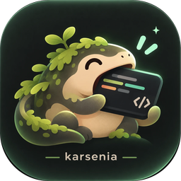

<p align="center">
  
</p>

# Karsenia

**English** · [한국어](#한국어)

A desktop-style host for [Claude Code](https://claude.com/claude-code). A Rust core runs the `claude` CLI headless
(`--input-format stream-json --output-format stream-json`) and gives it a chat window of its own: a native desktop app
(Slint, no browser, no network listener unless you switch on the local live view) or a local web page. It adds what a terminal does not show at a glance: permission
cards that wait for you, several accounts kept apart, usage and cost, notes and skills, git-worktree chats, and one board that
shows every chat at once.

> Status: early (v0.1.5). The Linux test suite is large; Windows has no automated tests, only hand use; the macOS app is built
> but has never been run on a Mac. Expect rough edges.

**Contents:** [Download](#download) · [First run](#first-run) · [A tour of the desktop app](#a-tour-of-the-desktop-app) ·
[What it does](#what-it-does) · [Settings and data](#settings-and-data) · [Build and run](#build-and-run) ·
[Tests, CI and releases](#tests-ci-and-releases) · [Troubleshooting](#troubleshooting) · [Security](#security) ·
[Repository map](#repository-map) · [Versions](#versions) · [License](#license)

## Download

**[Releases](https://github.com/nathak/karsenia/releases/latest)** has one zip per platform and a `.sha256` file next to each:

| Platform | File | State |
|---|---|---|
| Windows 10/11, x86-64 | `karsenia-desktop-<version>-windows-x86_64.zip` | tried by hand on Windows; no automated test there |
| macOS 11+, Apple silicon and Intel (universal) | `karsenia-desktop-<version>-macos-universal.zip` (from 0.1.4) | **experimental: compiled and packaged by CI, never run on a Mac** |
| Linux | build from source (below) | what the tests run on |

Check the zip against its `.sha256` file (`sha256sum -c`, or `shasum -a 256 -c` on a Mac) before you unpack it. The 0.1.0 release was
published before the rename and is named `tenrec-desktop-0.1.0-…`. From 0.1.3 on the zips are built by GitHub Actions from the
release's tag (`.github/workflows/release.yml`; the Linux tests run first), not on a personal machine.

**Needs `claude` (Claude Code) installed and logged in.** The app runs it; it does not replace it.

**Windows.** Unzip, double-click `karsenia-desktop.exe`. The `.exe` is **not signed**: Windows SmartScreen or a company security product may
warn about an unknown program. `sign-windows.ps1` in the zip signs it on your own PC with a self-signed certificate; that makes the file
tamper-evident, but it does not make a security product trust it. Do not try to get around a company's security product: ask its
administrator to allow the file.

**macOS (experimental).** Unzip, move `Karsenia.app` to Applications, open it. The app is not signed by an Apple developer and not notarized (it carries
only an ad-hoc signature), so macOS says it cannot check it: on your own Mac, right-click → Open → Open, or System Settings → Privacy &
Security → "Open Anyway". On a company-managed Mac ask the administrator. A program opened from Finder does not get your shell's `PATH`, so the
app looks for `claude` in the usual places (`~/.local/bin`, `~/.claude/local`, `~/.npm-global/bin`, `~/.bun/bin`, `~/.volta/bin`,
`/opt/homebrew/bin`, `/usr/local/bin`); if yours is elsewhere, set `TENREC_CLAUDE=/full/path/to/claude` and start the app from that terminal.
Not on macOS: notifications and the tray icon; the terminal page has never been tried there. `READ-ME-FIRST.txt` in the zip repeats this.

**Removing it.** Nothing is installed: delete the unzipped folder (Windows) or `Karsenia.app` (macOS). Your chats and settings stay in the data folder
(`~/.local/share/tenrec`, `%USERPROFILE%\.local\share\tenrec` on Windows); delete that folder too if you want them gone. Worktrees of chats are in `~/tenrec-worktrees`
(or your `worktree_root`) with branches `tenrec/<id>` in your projects; clean them up from the chat before you delete the data.

## First run

1. Install Claude Code and log in once in a terminal (`claude`), so that the program has a login.
2. Start the app. Pick **New chat**, choose a project folder, optionally a model, an account and a permission mode, and start.
3. Send a message. When Claude wants to run a tool that needs your permission, a card waits for your click (nothing is allowed on its own).
4. Only one app runs per data folder: quit an older build from its tray icon first.

The window follows the system theme or the one you pick in Settings; the interface is in Korean or English (Settings → language).

## A tour of the desktop app

The sidebar has the account choice, the pages, the search box and the chat list. Pages are reached with `Alt+1` … `Alt+8` (or `Ctrl+1` … `Ctrl+8`),
the sidebar, or the command palette (`Ctrl+K`). `Ctrl+=`, `Ctrl+-`, `Ctrl+0` zoom the whole window.

| Page | Key | What it is for |
|---|---|---|
| Chats | `1` | the open chat; the header shows the title, status, cost and tokens, with a **more** (`⋯`) menu for what a narrow window leaves out (archive, rename, text view, debug, continue in another account, delete) |
| Memory | `2` | notes of the project and of you; Claude proposes, you approve |
| Skills | `3` | skills with a risk report and version history |
| Schedule | `4` | scheduled tasks; **Settings** (accounts, providers, budgets, language, theme) is the other tab of the same page, from the button at the bottom of the sidebar |
| Files | `5` | the project's file tree and editor |
| Team | `6` | the chat's workbench: goal, constraints, done conditions, guard level, team mode with sub-agents, the live view |
| VHDB | `7` | what the VHDB plug-in left in the project (read only) |
| **Board** | `8` | **one line for every chat of every account** (see below) |

**The board** shows, for each chat: its state (a question waits, working, done, ended, failed), progress (the tool it used most this turn and how
long it has worked, or how long ago it stopped), the changes of a worktree chat (`+inserted −deleted (files)`), whether it can be merged
(ready, behind n, conflict n, uncommitted n, blocked, git settings changed …), its cost, and signs worth a look: the same call repeated,
many files edited, calls a guard held, work longer than 10 minutes, a failed last turn, a nearly full context window. Filter by waiting, working, blocked or
signs; order by need, recent activity, cost or name. The board only shows: a click goes to the chat, nothing there approves, merges or removes.
Worktrees are looked at through the same checks as the chat's **병합 점검** button, a few at a time and only while the page is open
([design](docs/design/board.md)).

## What it does

- **Chats.** One `claude` process per chat with several turns, streaming text, images (paste, pick), tool cards with input and
  result, sub-agents nested under their card, thinking lines, code blocks with copy and folding, tables, cost and token counts,
  a "view as text" mode where a whole conversation can be selected and copied, interrupt, background jobs shown while a chat waits for them,
  reopen or resume after a restart, and **archive** (put a chat away instead of deleting it; hidden unless shown, working or waiting).
- **Permissions stay yours.** The host starts `claude` with `--permission-prompt-tool stdio`. A permission request waits for your
  click: no timeout, no auto-allow, an answer is bound to the request shown. Claude Code's own settings (allow rules, modes,
  hooks) still decide first, as in a terminal, so open only projects you would run `claude` in.
- **Project check and project trust.** Before a normal chat starts `claude` in a project, the host reads the project's own Claude Code
  settings (`.claude/settings*.json`, `.mcp.json`: hooks, redirecting `env`, credential helpers, wide allow rules, a never-asking mode,
  plug-ins, MCP servers) and, if something there can run commands or send your login elsewhere, the desktop app shows a card: trust it,
  start without the project's settings, or decide later (the web page shows the reason as text). The card can also **remember** your trust for
  the project (per account; only the exact settings shown; never for a question you declined; worktree chats still ask each time); the new-chat form
  says when trust is remembered and can forget it.
- **New-chat form that remembers.** Per project it fills in the model, permission mode, account and worktree choice you used last (never
  bypass-permissions, never for provider or container chats), holds a start back for a moment if the form filled itself in so you can see it, and lists
  your **recent projects** under the folder field.
- **Commands.** The composer's "/" menu (desktop) lists the program's built-in commands (`/compact`, `/context`, `/cost`, `/usage`,
  `/model`, `/clear`) and the chat's skills and plug-in commands; a command is sent alone so Claude Code runs it itself. Between
  turns a chat changes its model in place when the program allows it, otherwise with a quick resume.
- **Accounts.** Several logins (for example personal and work) kept apart, chosen with one select box in the sidebar, each with its own notes,
  skills, history and usage limits; Codex logins can be managed too (chats run through Claude Code only). This keeps uses apart; it is not isolation.
- **Usage and cost.** Each account's 5-hour and weekly limits (from what a running `claude` reports, refreshed on request with the
  program's own `/usage`), and what it cost today, in 7 days and this month (estimates), with optional daily and monthly budgets
  across all accounts and a notice near them.
- **Memory, skills, search.** Notes that Claude proposes and you approve; skills with a risk report and version history;
  full-text search over all chats.
- **Scheduled tasks** (read-only file tasks or web tasks), **model providers and gateways** (Anthropic-compatible
  endpoints with your own key and request headers, optionally in a container; or a gateway that uses an account's login), chats
  in their **own git worktree** (a new branch `tenrec/<id>`; check, merge and clean up from the chat; the project's git settings are watched).
- **Files.** A project file tree and editor; Markdown is rendered and source files are syntax-coloured. Paths outside the
  project and dangerous paths are refused.
- **Live view.** A read-only local web page of what the chats do (prompts, tool calls with risk and guard marks, tokens), opened
  from the Team page or with `tenrec --live`. Bound to `127.0.0.1`, token in the address fragment, secrets masked.
- **Workbench and Team page.** A per-chat workbench (goal, constraints, pins, done conditions, guard rules, team mode with
  explorer and advisor sub-agents) that the app hands to the model and enforces with a guard hook. It is always on in the desktop
  app (the SmartWorkbench plug-in is switched off in its chats); the web server uses it when the setting is on, otherwise the plug-in.
- **Desktop extras.** On Windows, closing the window hides it to a tray icon. Notices (a Windows tray balloon; `notify-send` on
  Linux) when a chat waits for a permission, a long turn ends or the program stops with an error, and near a budget.
  Interface in Korean and English.

The long design notes, behaviour details and known limits are in [docs/NOTES.md](docs/NOTES.md).

## Settings and data

| What | Where / how |
|---|---|
| Sessions, notes, settings, logs | `~/.local/share/tenrec` (`%USERPROFILE%\.local\share\tenrec` on Windows); `--data <folder>` or `TENREC_DATA` changes it |
| The `claude` program | found on `PATH` (and, on macOS, in the usual places); `--claude <path>` or `TENREC_CLAUDE` names it |
| Crash and error log of the desktop app | `<data>/logs/desktop.log` — send this file when something goes wrong |
| Worktrees of chats | `worktree_root` in `<data>/settings.json`, else `~/tenrec-worktrees` |
| Per-project form defaults and remembered trust | `<data>/project_defaults.json`, `<data>/project_trust.json` (mode `0600`) |

The app was called Tenrec before: the data folder, the `TENREC_*` variables, the web server program `tenrec`, the MCP name `tenrec` and the
`tenrec/<id>` worktree branches keep that name so that nothing already saved is lost.

## Build and run

Rust (stable; the releases are built with 1.98.1) is needed. The bundled SQLite is C, so a C compiler is needed as well. On Linux the desktop app links
fontconfig and freetype (`libfontconfig1-dev libfreetype-dev` on Debian and Ubuntu).

```sh
cargo run                                   # web UI: prints http://127.0.0.1:PORT/#t=TOKEN, open that address
cargo run -- --port 4311 --data ./data --claude /path/to/claude
cargo run --features desktop --bin karsenia-desktop     # native desktop app (Slint), on Linux, macOS or Windows
cargo test --features desktop                           # no model calls: a fake `claude` replays scenarios
```

**Windows from Linux** (what the releases do): the target `x86_64-pc-windows-gnu` with `zig cc` as the C compiler and the linker; the two small
scripts that stand in for mingw-w64 are in [`packaging/windows-build/`](packaging/windows-build/README.md), and
`packaging/make-windows-zip.sh` makes the zip.
**macOS** (on a Mac): `cargo build --release --features desktop --bin karsenia-desktop` for `aarch64-apple-darwin` and `x86_64-apple-darwin`, joined with `lipo`;
`packaging/make-macos-zip.sh` makes `Karsenia.app` (ad-hoc signature) and the zip.

## Tests, CI and releases

- `cargo test --features desktop --locked` (about 900 tests, real git in temporary folders, a fake `claude`), `node --test tests/ui.test.mjs` (the web page's pure helpers).
  `cargo run --features desktop --example shots -- <folder>` draws the desktop window's screens to PNG files with Slint's software renderer (no display needed).
- `.github/workflows/ci.yml` runs the Linux tests and a Windows compile check on every push and pull request.
- A release is a tag: set `version` in `Cargo.toml`, write `docs/release-notes/vX.Y.Z.md`, commit and push, then `git tag -a vX.Y.Z -m … && git push origin vX.Y.Z`.
  `.github/workflows/release.yml` then runs the tests, builds the Windows zip (and, through `macos-build.yml`, the macOS zip) on clean runners and publishes the
  release with the zips and their checksums. A macOS problem never stops the Windows release. Started by hand, the workflows only build.
  No signing key is used anywhere; the programs are not signed by a publisher.

## Troubleshooting

- **"claude not found" or chats do not start.** Check `claude --version` in a terminal. On Windows only `claude.exe` is used. On macOS see the paths above and `TENREC_CLAUDE`.
- **Windows SmartScreen or a security product blocks the file.** See Download; ask the administrator rather than working around the product.
- **macOS says the app cannot be checked.** Right-click → Open, or System Settings → Privacy & Security → Open Anyway.
- **"Karsenia is already running".** Only one app runs per data folder: use the window that is open, or quit the other one from its tray icon (or give this one `--data`).
- **Something broke.** Send `<data>/logs/desktop.log` (the app writes what it reports and any crash there).

## Security

Local only: the web server binds `127.0.0.1`, checks `Host` and `Origin`, and needs a token; the desktop app has no listener unless you switch on the live view (a read-only page on `127.0.0.1` with its own token).
The app can run commands through Claude Code, so treat it like a terminal. This is **not a sandbox**. Open only projects you
trust: a project's own `.claude/settings.json` (hooks, `env`) applies to a normal chat once you trust it. Before a normal chat
starts, the host checks three of the project's Claude Code settings files and asks first (the project check); this lowers the risk,
it is not a sandbox (CLAUDE.md, skills and parent folders are not checked). The app does not store a claude.ai login or
subscription token itself (the `claude` program keeps its own); a gateway set to use an account's login sends that login to the
address you gave it: use it only for an address you trust. Details and known limits: [docs/NOTES.md](docs/NOTES.md#security).

## Repository map

`src/` the Rust core (`claude/` the CLI protocol and process, `session.rs` one chat, `registry.rs` all chats, `worktree.rs`, `board.rs`, `server/` the local web server) ·
`src/bin/desktop/` the desktop app's glue, `slint/` its screens, `src/view/` what the screens show and say (pure, tested) · `ui/` the web page ·
`tests/`, `examples/` · `packaging/` zips, signing script, build scripts · `.github/workflows/` CI and releases ·
[`docs/NOTES.md`](docs/NOTES.md) design notes and known limits · [`docs/design/board.md`](docs/design/board.md) the board's design ·
[`docs/release-notes/`](docs/release-notes/) the notes of each release.

## Versions

- **0.1.5** — the license: GPL-3.0-only from this version on; third-party notices, `SECURITY.md`, `CONTRIBUTING.md`; the Windows program carries its name and version.
  **0.1.4** — the macOS app (experimental), built by CI. **0.1.3** — the board, per-project form defaults, archive, project trust, one account select box, a more
  menu in the chat header; the Windows zip built by GitHub Actions. (0.1.2 was never released.)
- **0.1.1** — the name Karsenia and a new icon; the "/" menu; the project check; usage and cost with budgets; provider headers and gateways.
- **0.1.0** — the first public build, published as Tenrec.

## License

**GPL-3.0-only** (see [LICENSE](LICENSE)), from version 0.1.5 on. Karsenia's desktop app is built with [Slint](https://slint.dev), which is used here under
its GNU GPLv3 option, so the program as a whole is GPL-3.0-only; the third-party crates are under MIT, Apache-2.0 and similar licenses that are compatible with it
(the list is in [THIRD-PARTY-NOTICES.txt](THIRD-PARTY-NOTICES.txt)). Fonts (Pretendard, JetBrains Mono) are under the SIL Open Font License, shipped as separate
files; their texts are in `ui/vendor/`. The source of every release is this repository at the release's tag.
Versions up to 0.1.4 were published with the source code under the MIT license and the program built with Slint under its Royalty-free Desktop License; those
releases stay as they were published. Contributions are accepted under GPL-3.0-only (see [CONTRIBUTING.md](CONTRIBUTING.md)); security reports: [SECURITY.md](SECURITY.md).

---

<a id="한국어"></a>

# Karsenia (한국어)

[English](#karsenia) · **한국어**

[Claude Code](https://claude.com/claude-code)를 위한 데스크톱형 호스트입니다. Rust 코어가 `claude` CLI를 헤드리스
(`--input-format stream-json --output-format stream-json`)로 실행하고, 전용 채팅 화면을 제공합니다. 화면은 네이티브
데스크톱 앱(Slint, 브라우저 없음, 로컬 라이브 보기를 켜지 않으면 네트워크 수신 포트 없음)이거나 로컬 웹 페이지입니다. 터미널에서는 한눈에 보이지 않는 것을 더합니다:
사용자의 클릭을 기다리는 권한 카드, 따로 두는 여러 계정, 사용량과 비용, 메모와 스킬, git worktree 채팅, 모든 채팅을 한 화면에 모은 보드.

> 상태: 초기 단계(v0.1.5). 리눅스용 테스트는 많지만 Windows는 자동 테스트 없이 손으로만 확인했습니다. macOS 앱은 빌드만 되고
> Mac에서 실행해 본 적이 없습니다. 거친 부분이 있을 수 있습니다.

**목차:** [내려받기](#내려받기) · [처음 실행](#처음-실행) · [데스크톱 앱 둘러보기](#데스크톱-앱-둘러보기) · [기능](#기능) ·
[설정과 데이터](#설정과-데이터) · [빌드와 실행](#빌드와-실행) · [테스트, CI, 릴리스](#테스트-ci-릴리스) · [문제 해결](#문제-해결) ·
[보안](#보안) · [저장소 구성](#저장소-구성) · [버전](#버전) · [라이선스](#라이선스)

## 내려받기

**[Releases](https://github.com/nathak/karsenia/releases/latest)**에 플랫폼마다 zip 하나와 옆에 `.sha256` 파일이 있습니다.

| 플랫폼 | 파일 | 상태 |
|---|---|---|
| Windows 10/11, x86-64 | `karsenia-desktop-<버전>-windows-x86_64.zip` | Windows에서 손으로 확인, 자동 테스트 없음 |
| macOS 11 이상, Apple 실리콘과 Intel(유니버설) | `karsenia-desktop-<버전>-macos-universal.zip`(0.1.4부터) | **실험적: CI가 컴파일·패키징만 했고 Mac에서 실행해 본 적 없음** |
| Linux | 소스에서 빌드(아래) | 테스트가 도는 환경 |

압축을 풀기 전에 `.sha256` 파일로 확인하세요(`sha256sum -c`, Mac은 `shasum -a 256 -c`). 0.1.0 릴리스는 이름을 바꾸기 전에 올린 것이라
`tenrec-desktop-0.1.0-…`입니다. 0.1.3부터 zip은 개인 PC가 아니라 릴리스 태그에서 GitHub Actions가 만듭니다(`.github/workflows/release.yml`,
빌드 전에 리눅스 테스트를 먼저 돌립니다).

**`claude`(Claude Code)가 설치되고 로그인되어 있어야 합니다.** 이 앱은 `claude`를 실행할 뿐 대신하지 않습니다.

**Windows.** 압축을 풀고 `karsenia-desktop.exe`를 실행합니다. `.exe`는 **서명되어 있지 않습니다**. Windows SmartScreen이나 회사 보안 제품이
모르는 프로그램이라고 경고할 수 있습니다. 압축 안의 `sign-windows.ps1`은 본인 PC에서 자체 서명 인증서로 서명합니다. 변조 여부를 알 수 있게 될
뿐, 보안 제품이 신뢰하게 만들지는 못합니다. 회사 보안 제품을 우회하려 하지 말고, 관리자에게 이 파일을 허용해 달라고 요청하세요.

**macOS(실험적).** 압축을 풀고 `Karsenia.app`을 응용 프로그램 폴더로 옮겨 엽니다. Apple 개발자 서명과 공증이 없고(임시 서명만 있음) macOS가
확인할 수 없다고 하므로, 본인 Mac에서는 우클릭 → 열기 → 열기, 또는 시스템 설정 → 개인정보 보호 및 보안 → "그래도 열기"로 허용합니다.
회사에서 관리하는 Mac이면 관리자에게 문의하세요. Finder에서 연 앱은 셸의 `PATH`를 받지 못하므로, 앱은 `claude`가 흔히 있는 곳
(`~/.local/bin`, `~/.claude/local`, `~/.npm-global/bin`, `~/.bun/bin`, `~/.volta/bin`, `/opt/homebrew/bin`, `/usr/local/bin`)을 찾아봅니다. 다른 곳에
있으면 `TENREC_CLAUDE=/전체/경로/claude`를 지정하고 그 터미널에서 앱을 시작하세요. macOS에는 알림과 트레이 아이콘이 없고, 터미널 화면은
시도해 본 적이 없습니다. zip 안의 `READ-ME-FIRST.txt`에도 같은 내용이 있습니다.

**제거.** 설치되는 것은 없습니다. 압축을 푼 폴더(Windows) 또는 `Karsenia.app`(macOS)을 지우면 됩니다. 채팅과 설정은 데이터 폴더
(`~/.local/share/tenrec`, Windows는 `%USERPROFILE%\.local\share\tenrec`)에 남으므로, 없애려면 그 폴더도 지우세요. 채팅의 worktree는 `~/tenrec-worktrees`(또는
`worktree_root`)에, 브랜치 `tenrec/<id>`는 프로젝트에 있으니 데이터를 지우기 전에 채팅에서 정리하세요.

## 처음 실행

1. Claude Code를 설치하고 터미널에서 한 번 `claude`로 로그인합니다.
2. 앱을 시작합니다. **새 대화**에서 프로젝트 폴더를 고르고, 필요하면 모델, 계정, 권한 모드를 고른 뒤 시작합니다.
3. 메시지를 보냅니다. Claude가 권한이 필요한 도구를 실행하려 하면 카드가 클릭을 기다립니다(스스로 허용하는 것은 없습니다).
4. 데이터 폴더마다 앱은 하나만 실행됩니다. 이전 빌드가 켜져 있으면 트레이 아이콘에서 먼저 종료하세요.

화면은 시스템 테마 또는 설정에서 고른 테마를 따르고, 인터페이스는 한국어와 영어입니다(설정 → 언어).

## 데스크톱 앱 둘러보기

사이드바에 계정 선택, 페이지, 검색창, 채팅 목록이 있습니다. 페이지는 `Alt+1` … `Alt+8`(또는 `Ctrl+1` … `Ctrl+8`), 사이드바, 명령 팔레트(`Ctrl+K`)로
갑니다. `Ctrl+=`, `Ctrl+-`, `Ctrl+0`은 창 전체 확대·축소입니다.

| 페이지 | 키 | 용도 |
|---|---|---|
| 대화 | `1` | 열린 채팅. 헤더에 제목, 상태, 비용, 토큰이 있고, 좁은 창에서 밀려난 것(보관, 이름 변경, 텍스트로 보기, 디버그, 다른 계정으로 이어 가기, 삭제)은 **더보기**(`⋯`) 메뉴에 있습니다 |
| 메모리 | `2` | 프로젝트와 사용자의 메모. Claude가 제안하고 사용자가 승인합니다 |
| 스킬 | `3` | 위험 보고서와 버전 기록이 있는 스킬 |
| 예약 | `4` | 예약 작업. **설정**(계정, 제공자, 예산, 언어, 테마)은 같은 페이지의 다른 탭이며 사이드바 아래의 버튼으로 엽니다 |
| 파일 | `5` | 프로젝트 파일 트리와 편집기 |
| 팀 | `6` | 채팅의 워크벤치: 목표, 제약, 완료 조건, 가드 단계, 서브 에이전트를 쓰는 팀 모드, 라이브 보기 |
| VHDB | `7` | VHDB 플러그인이 프로젝트에 남긴 것(읽기 전용) |
| **보드** | `8` | **모든 계정의 채팅을 한 줄씩**(아래) |

**보드**는 채팅마다 다음을 보여 줍니다: 상태(질문 대기, 실행 중, 끝남, 종료, 실패), 진행(이번 턴에 가장 많이 쓴 도구와 일한 시간, 또는 멈춘 지 얼마나
됐는지), worktree 채팅의 변경(`+삽입 −삭제 (파일 수)`), 병합 가능 여부(가능, 뒤처짐 n, 충돌 n, 미커밋 n, 막힘, git 설정 변경 …), 비용, 그리고 살펴볼 신호:
같은 호출 반복, 많은 파일 수정, 가드가 막은 호출, 10분 넘는 실행, 직전 턴 실패, 거의 찬 컨텍스트. 질문 대기·실행 중·막힘·신호로 거르고, 필요순·최근
활동·비용·이름으로 정렬합니다. 보드는 보여 주기만 합니다. 줄을 누르면 그 채팅으로 이동하고, 거기서 승인·병합·삭제를 하지 않습니다. worktree는 채팅의
**병합 점검** 버튼과 같은 확인으로, 페이지가 열려 있는 동안만 몇 개씩 봅니다([설계](docs/design/board.md)).

## 기능

- **채팅.** 채팅마다 `claude` 프로세스 하나로 여러 턴을 이어 가며, 글자 스트리밍, 이미지(붙여넣기·선택), 입력과 결과가 보이는
  도구 카드, 카드 아래에 중첩된 서브 에이전트, 생각 줄, 복사·접기가 되는 코드 블록, 표, 비용과 토큰, 대화 전체를 선택해
  복사하는 "텍스트로 보기", 중단, 채팅이 기다리는 백그라운드 작업 표시, 재시작 뒤 다시 열기와 이어 하기, 그리고 **보관**(삭제 대신 치워 두기.
  보이게 하거나 실행 중·질문 대기 중일 때만 목록에 나옵니다)을 지원합니다.
- **권한은 사용자 몫.** `--permission-prompt-tool stdio`로 `claude`를 띄웁니다. 권한 요청은 클릭을 기다리며 시간 초과도
  자동 허용도 없고, 답은 화면에 보이는 그 요청에만 묶입니다. Claude Code 자체 설정(허용 규칙, 모드, 훅)이 먼저 결정하는
  것은 터미널과 같으므로, `claude`를 실행해도 되는 프로젝트만 여세요.
- **프로젝트 확인과 프로젝트 신뢰.** 일반 채팅이 프로젝트에서 `claude`를 띄우기 전에 프로젝트 자체의 Claude Code 설정(`.claude/settings*.json`,
  `.mcp.json`: 훅, 접속을 돌리는 `env`, 자격 증명 명령, 넓은 허용 규칙, 묻지 않는 모드, 플러그인, MCP 서버)을 읽습니다. 명령을 실행하거나 로그인을 다른
  곳으로 보낼 수 있는 항목이 있으면 데스크톱 앱이 카드를 띄웁니다: 신뢰, 프로젝트 설정 없이 시작, 나중에(웹 화면은 이유를 글로 보여 줍니다). 카드에서
  그 프로젝트에 대한 신뢰를 **기억**할 수도 있습니다(계정별, 보여 준 설정 그대로일 때만, 거절한 질문은 기억하지 않음, worktree 채팅은 매번 묻습니다). 새 대화 폼이
  신뢰가 기억되어 있음을 알려 주고 잊을 수 있습니다.
- **기억하는 새 대화 폼.** 프로젝트마다 지난번의 모델, 권한 모드, 계정, worktree 선택을 채워 주고(권한 우회 모드나 제공자·컨테이너 채팅에는 쓰지 않음), 폼이 스스로 채운
  직후의 시작은 잠시 막아 확인할 수 있게 하며, 폴더 입력란 아래에 **최근 프로젝트**를 보여 줍니다.
- **명령.** 입력창의 "/" 메뉴(데스크톱)에 프로그램 내장 명령(`/compact`, `/context`, `/cost`, `/usage`, `/model`, `/clear`)과
  채팅의 스킬·플러그인 명령이 나옵니다. 명령은 단독으로 보내져 Claude Code가 직접 실행합니다. 턴 사이에는 프로그램이 허용하면
  그 자리에서, 아니면 짧게 이어 시작해 모델을 바꿉니다.
- **계정.** 개인용·업무용 같은 여러 로그인을 사이드바의 선택 상자 하나로 고르고, 계정마다 메모, 스킬, 기록, 사용 한도가 분리됩니다. Codex 로그인도
  관리할 수 있습니다(채팅은 Claude Code로만 실행). 사용을 구분해 줄 뿐 격리는 아닙니다.
- **사용량과 비용.** 계정별 5시간·주간 한도(실행 중인 `claude`가 알려 주는 값, 요청하면 프로그램 자체의 `/usage`로 새로 읽음)와
  오늘·7일·이번 달 비용(추정)을 보여 줍니다. 모든 계정을 합친 일·월 예산을 선택적으로 정할 수 있고, 예산에 가까워지면 알립니다.
- **메모리·스킬·검색.** Claude가 제안하고 사용자가 승인하는 메모, 위험 보고서와 버전 기록이 있는 스킬, 모든 채팅 전문 검색.
- **예약 작업**(읽기 전용 파일 작업, 웹 작업), **모델 제공자와 게이트웨이**(내 키와 요청 헤더를 쓰는 Anthropic 호환 주소, 선택적으로 컨테이너; 또는 계정 로그인을
  쓰는 게이트웨이), 채팅별 **git worktree**(새 브랜치 `tenrec/<id>`, 채팅에서 점검·병합·정리, 프로젝트의 git 설정을 감시).
- **파일.** 프로젝트 파일 트리와 편집기. Markdown은 렌더링하고 소스 파일은 구문 색을 입힙니다. 프로젝트 밖 경로와 위험한 경로는
  거부합니다.
- **라이브 보기.** 채팅이 하는 일(프롬프트, 위험·가드 표시가 붙은 도구 호출, 토큰)을 보여 주는 읽기 전용 로컬 웹 화면입니다.
  팀 화면이나 `tenrec --live`로 엽니다. `127.0.0.1`에만 열리고 토큰은 주소의 `#` 뒤에 있으며 비밀값은 가립니다.
- **워크벤치와 팀 화면.** 채팅별 워크벤치(목표, 제약, 핀, 완료 조건, 가드 규칙, explorer·advisor 서브 에이전트를 쓰는 팀 모드)를
  앱이 모델에 넘기고 가드 훅으로 지킵니다. 데스크톱 앱에서는 항상 켜져 있고(그 채팅에서는 SmartWorkbench 플러그인을 끕니다),
  웹 서버는 설정을 켰을 때 이것을, 아니면 플러그인을 씁니다.
- **데스크톱 부가 기능.** Windows에서는 창을 닫으면 트레이 아이콘으로 숨습니다. 채팅이 권한을 기다릴 때, 오래 걸린 턴이 끝났을 때,
  프로그램이 오류로 멈췄을 때, 예산에 가까울 때 알림을 띄웁니다(Windows 트레이 풍선, Linux는 `notify-send`).
  화면은 한국어와 영어를 지원합니다.

자세한 설계 메모, 동작 세부, 알려진 한계는 [docs/NOTES.md](docs/NOTES.md)(영어)에 있습니다.

## 설정과 데이터

| 무엇 | 어디에 / 어떻게 |
|---|---|
| 세션, 메모, 설정, 로그 | `~/.local/share/tenrec`(Windows는 `%USERPROFILE%\.local\share\tenrec`). `--data <폴더>` 또는 `TENREC_DATA`로 바꿉니다 |
| `claude` 프로그램 | `PATH`에서 찾음(macOS는 흔한 위치도). `--claude <경로>` 또는 `TENREC_CLAUDE`로 지정 |
| 데스크톱 앱의 오류·충돌 로그 | `<데이터>/logs/desktop.log` — 문제가 생기면 이 파일을 보내 주세요 |
| 채팅의 worktree | `<데이터>/settings.json`의 `worktree_root`, 없으면 `~/tenrec-worktrees` |
| 프로젝트별 폼 기본값과 기억된 신뢰 | `<데이터>/project_defaults.json`, `<데이터>/project_trust.json`(권한 `0600`) |

예전 이름이 Tenrec이었습니다. 이미 저장된 것이 사라지지 않도록 데이터 폴더, `TENREC_*` 변수, 웹 서버 프로그램 `tenrec`, MCP 이름 `tenrec`,
`tenrec/<id>` 작업 트리 브랜치는 그 이름을 그대로 씁니다.

## 빌드와 실행

Rust(stable, 릴리스는 1.98.1로 빌드)가 필요하고, 내장 SQLite가 C라서 C 컴파일러도 필요합니다. Linux에서 데스크톱 앱은 fontconfig와 freetype을 링크합니다
(Debian·Ubuntu는 `libfontconfig1-dev libfreetype-dev`).

```sh
cargo run                                   # 웹 화면: http://127.0.0.1:PORT/#t=TOKEN 이 출력되면 그 주소를 엽니다
cargo run -- --port 4311 --data ./data --claude /path/to/claude
cargo run --features desktop --bin karsenia-desktop     # 네이티브 데스크톱 앱(Slint), Linux·macOS·Windows
cargo test --features desktop                           # 모델 호출 없음: 가짜 `claude`가 시나리오를 재생
```

**리눅스에서 Windows용 빌드**(릴리스가 쓰는 방식): 대상 `x86_64-pc-windows-gnu`, C 컴파일러와 링커로 `zig cc`를 씁니다. mingw-w64 대신 하는 작은 스크립트
둘은 [`packaging/windows-build/`](packaging/windows-build/README.md)에 있고, zip은 `packaging/make-windows-zip.sh`가 만듭니다.
**macOS**(Mac에서): `aarch64-apple-darwin`과 `x86_64-apple-darwin`용으로 `cargo build --release --features desktop --bin karsenia-desktop`을 하고 `lipo`로 합칩니다.
`packaging/make-macos-zip.sh`가 `Karsenia.app`(임시 서명)과 zip을 만듭니다.

## 테스트, CI, 릴리스

- `cargo test --features desktop --locked`(약 900개, 임시 폴더의 실제 git과 가짜 `claude`), `node --test tests/ui.test.mjs`(웹 화면의 순수 함수).
  `cargo run --features desktop --example shots -- <폴더>`는 Slint 소프트웨어 렌더러로 데스크톱 창의 화면을 PNG로 그립니다(디스플레이 불필요).
- `.github/workflows/ci.yml`이 push와 pull request마다 리눅스 테스트와 Windows 컴파일 검사를 돌립니다.
- 릴리스는 태그입니다. `Cargo.toml`의 `version`을 올리고 `docs/release-notes/vX.Y.Z.md`를 쓴 뒤 커밋·푸시하고 `git tag -a vX.Y.Z -m … && git push origin vX.Y.Z`를 합니다.
  그러면 `.github/workflows/release.yml`이 테스트를 돌리고, 깨끗한 러너에서 Windows zip(그리고 `macos-build.yml`을 통해 macOS zip)을 빌드해 zip과 체크섬으로
  릴리스를 게시합니다. macOS 문제는 Windows 릴리스를 막지 않습니다. 손으로 실행하면 빌드만 합니다. 서명 키는 어디에도 쓰지 않으며, 프로그램은 발행자 서명이 없습니다.

## 문제 해결

- **"claude를 찾을 수 없음"이거나 채팅이 시작되지 않음.** 터미널에서 `claude --version`을 확인하세요. Windows에서는 `claude.exe`만 씁니다. macOS는 위의 경로와 `TENREC_CLAUDE`를 보세요.
- **Windows SmartScreen이나 보안 제품이 파일을 막음.** 내려받기를 보고, 제품을 우회하려 하지 말고 관리자에게 문의하세요.
- **macOS가 앱을 확인할 수 없다고 함.** 우클릭 → 열기, 또는 시스템 설정 → 개인정보 보호 및 보안 → 그래도 열기.
- **"Karsenia가 이미 실행 중입니다".** 데이터 폴더마다 앱은 하나만 실행됩니다. 열려 있는 창을 쓰거나, 다른 앱을 트레이 아이콘에서 종료하세요(또는 이 앱에 `--data`를 주세요).
- **문제가 생겼을 때.** `<데이터>/logs/desktop.log`를 보내 주세요(앱이 보고한 것과 충돌 내용이 기록됩니다).

## 보안

로컬 전용입니다. 웹 서버는 `127.0.0.1`에만 열리고 `Host`와 `Origin`을 검사하며 토큰이 필요합니다. 데스크톱 앱은 라이브 보기(자체 토큰이 있는 `127.0.0.1`의
읽기 전용 페이지)를 켜지 않으면 수신 포트가 없습니다. 이 앱은 Claude Code를 통해 명령을 실행할 수 있으므로 터미널처럼 다루세요. **샌드박스가 아닙니다.** 신뢰하는
프로젝트만 여세요. 신뢰한 뒤에는 일반 채팅에 프로젝트의 `.claude/settings.json`(훅, `env`)이 적용됩니다. 일반 채팅을 시작하기 전에
프로젝트의 Claude Code 설정 파일 세 개를 확인하고 먼저 묻습니다(프로젝트 확인). 위험을 줄일 뿐 샌드박스는 아닙니다(CLAUDE.md, 스킬,
상위 폴더는 확인하지 않음). 앱은 claude.ai 로그인이나 구독 토큰을 직접 저장하지 않습니다(`claude` 프로그램이 자체 보관). 계정 로그인을
쓰는 게이트웨이는 그 로그인을 입력한 주소로 보내므로 믿을 수 있는 주소에만 쓰세요. 자세한 내용과 한계: [docs/NOTES.md](docs/NOTES.md#security).

## 저장소 구성

`src/` Rust 코어(`claude/` CLI 프로토콜과 프로세스, `session.rs` 채팅 하나, `registry.rs` 모든 채팅, `worktree.rs`, `board.rs`, `server/` 로컬 웹 서버) ·
`src/bin/desktop/` 데스크톱 앱 연결 코드, `slint/` 화면, `src/view/` 화면이 보여 주고 말하는 것(순수 함수, 테스트됨) · `ui/` 웹 화면 ·
`tests/`, `examples/` · `packaging/` zip, 서명 스크립트, 빌드 스크립트 · `.github/workflows/` CI와 릴리스 ·
[`docs/NOTES.md`](docs/NOTES.md) 설계 메모와 알려진 한계 · [`docs/design/board.md`](docs/design/board.md) 보드 설계 ·
[`docs/release-notes/`](docs/release-notes/) 릴리스별 노트.

## 버전

- **0.1.5** — 라이선스: 이 버전부터 GPL-3.0-only. 제3자 고지, `SECURITY.md`, `CONTRIBUTING.md`, Windows 프로그램에 이름과 버전 정보.
  **0.1.4** — macOS 앱(실험적), CI가 빌드. **0.1.3** — 보드, 프로젝트별 폼 기본값, 보관, 프로젝트 신뢰, 계정 선택 상자 하나, 채팅 헤더의 더보기 메뉴,
  GitHub Actions가 만드는 Windows zip. (0.1.2는 릴리스되지 않았습니다.)
- **0.1.1** — Karsenia라는 이름과 새 아이콘, "/" 메뉴, 프로젝트 확인, 예산이 있는 사용량·비용, 제공자 헤더와 게이트웨이.
- **0.1.0** — 처음 공개한 빌드(이름은 Tenrec).

## 라이선스

**GPL-3.0-only**입니다([LICENSE](LICENSE)). 0.1.5부터 적용됩니다. 데스크톱 앱은 [Slint](https://slint.dev)로 만들고 Slint는 GNU GPLv3 선택지로 쓰므로 프로그램 전체가
GPL-3.0-only이며, 제3자 크레이트는 이와 호환되는 MIT, Apache-2.0 등입니다(목록은 [THIRD-PARTY-NOTICES.txt](THIRD-PARTY-NOTICES.txt)). 글꼴(Pretendard, JetBrains Mono)은
SIL Open Font License이고 별도 파일로 들어 있으며 전문은 `ui/vendor/`에 있습니다. 각 릴리스의 소스는 이 저장소의 해당 태그입니다.
0.1.4까지는 소스 코드를 MIT로, 프로그램을 Slint의 Royalty-free Desktop License로 빌드해 공개했고 그 릴리스들은 공개된 그대로 남습니다. 기여는 GPL-3.0-only로 받습니다
([CONTRIBUTING.md](CONTRIBUTING.md)). 보안 문제 제보: [SECURITY.md](SECURITY.md).
